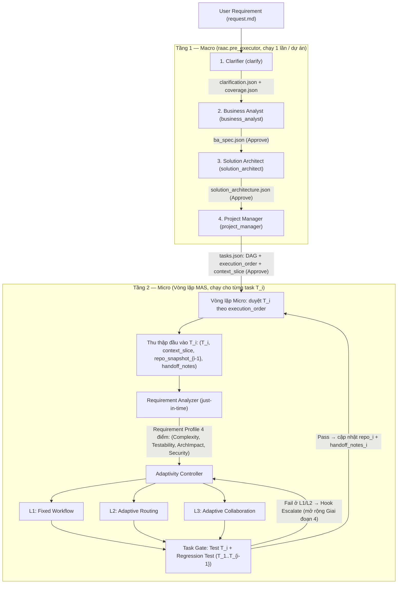

# Kiến trúc tổng thể Hai tầng (Macro–Micro) & Đánh giá theo Proposal RAAC

Ngày lập: 2026-11-23  
Tài liệu nền tảng: [Proposal_DACN.pdf](../Proposal_DACN.pdf) · [level_definitions.md](level_definitions.md) · [architecture.md](architecture.md)  
Kế hoạch triển khai Tầng Macro tương ứng: [pre_executor_clarifier_ba_plan.md](pre_executor_clarifier_ba_plan.md) · [pre_executor_sa_pm_plan.md](pre_executor_sa_pm_plan.md)

---

## 1. Tổng quan Kiến trúc Hai tầng (Macro & Micro)

Thay vì ép các mức điều phối `L1 / L2 / L3` phải ôm trọn một yêu cầu sản phẩm lớn trong một lượt chạy (dễ nổ context, trôi mục tiêu, khó kiểm thử) hoặc chạy 4 role phân tích/kiến trúc cho từng bug nhỏ lẻ (lãng phí tài nguyên), hệ thống được tổ chức thành **hai tầng tách biệt về phạm vi và vòng đời**:

- **Tầng 1 — Macro (`raac.pre_executor`, chạy 1 lần cho toàn dự án):** Chuyển yêu cầu người dùng từ ý tưởng/đặc tả lớn thành **Global Architecture Contract bất biến** và **DAG các task nhỏ (`T1..Tn`)** kèm ngữ cảnh cắt lát (`context_slice`) được tạo tự động bằng code.
- **Tầng 2 — Micro (Vòng lặp thực thi MAS, lặp theo thứ tự topo của DAG):** Với **từng task nhỏ $T_i$**, chụp trạng thái mã nguồn thực tế sau $T_{i-1}$, gọi **`Requirement Analyzer` just-in-time** để sinh **Requirement Profile 4 điểm** `(Complexity, Testability, Architecture Impact, Security)` *(điều chỉnh thay trục `Ambiguity` gốc của Proposal bằng `Testability` vì `Clarifier` ở Tầng Macro đã xử lý độ mơ hồ đầu vào)*, sau đó **`Adaptivity Controller`** chọn mức điều phối **`L1 / L2 / L3`** phù hợp nhất để triển khai code và kiểm thử.

### 1.1. Sơ đồ luồng tổng thể

### 1.2. Chuỗi Artifact và Truy vết xuyên suốt (End-to-End Traceability)

Mọi thực thể giữa các bước đều mang định danh tường minh, được kiểm tra toàn vẹn bằng luật code và khóa phiên bản bằng SHA-256 (`approvals.json`):

| Tầng | Bước / Thành phần | Artifact đầu ra | Định danh & nội dung cốt lõi |
| --- | --- | --- | --- |
| **Macro** | Input | `request.md` | Yêu cầu gốc hoặc bản spec ban đầu |
| **Macro** | `Clarifier` | `clarification.json`, `coverage.json` | `Q1..Qn` (kèm cờ `assumed: true/false`), bảng độ phủ 10 nhóm Spec Kit (`clear/resolved/deferred/outstanding/not_applicable`) |
| **Macro** | `Business Analyst` | `ba_spec.json` / `.md` | `F-n`, `SC-n`, `ENT-n`, `NFR-n` (gắn `feature_ids`), `INT-n`, `UF-n`, `BR-n`, `FR-n`, `FR-n.ACm`, `EC-n`, `Assumptions` (gắn `feature_ids`), `OQ-n` |
| **Macro** | `Solution Architect` | `solution_architecture.json` / `.md` | `TechStack`, `folders`, `MOD-n` (DAG không vòng), `DM-n` (trỏ `ENT-n`), `API-n` (trỏ `FR-n`, `INT-n`), `SecurityArchitecture` (trỏ `NFR-n` security), `RuntimeContract` (`test_command`), `CON-n` bất biến, `ADR-n`, `open_assumptions` |
| **Macro** | `Project Manager` | `tasks.json` / `.md` | `T1..Tn` (DAG không vòng, **không** chấm điểm/chọn level), `execution_order` (Kahn topo deterministic), `global_tech_stack`, `global_runtime_contract`, và `context_slice` (hydrate bằng Python theo ID tham chiếu của từng $T_i$) |
| **Micro** | `Requirement Analyzer` | `requirement_profile` (per-task runtime) | **Bộ 4 điểm** `(Complexity, Testability, Architecture Impact, Security)` tính just-in-time từ `(T_i, context_slice, repo_snapshot_{i-1})` |
| **Micro** | `Adaptivity Controller` | `level_decision` (per-task runtime) | Ánh xạ 4 điểm → `L1 / L2 / L3` kèm lý do diễn giải được (interpretable) |
| **Micro** | `L1 / L2 / L3` + `Task Gate` | Code changes (`repo_i`), test report, `handoff_notes_i` | Mã nguồn cập nhật, kết quả unit/AC test + regression test, ghi chú file đã tạo & sai lệch kỹ thuật nếu có |

> **Chuẩn hóa thuật ngữ & Điều chỉnh 4 trục:** Sau khi hợp nhất BA thành `ba_spec.json` ([pre_executor_clarifier_ba_plan.md](pre_executor_clarifier_ba_plan.md)), cụm từ **“Requirement Profile”** chỉ dùng duy nhất cho **tổ hợp 4 điểm `(Complexity, Testability, Architecture Impact, Security)`** ở Tầng Micro. Trục **`Testability`** thay thế trục `Ambiguity` trong bản gốc [Proposal_DACN.pdf](../Proposal_DACN.pdf) (Mục 6.3) vì độ mơ hồ yêu cầu ban đầu đã được `Clarifier` và `BA` giải quyết ở Tầng Macro.

---

## 2. Phân ranh giới trách nhiệm: Macro vs Micro

Một rủi ro kiến trúc lớn khi đặt `Clarifier → BA → SA → PM` trước `L1/L2/L3` là **lặp việc** (cả hai tầng cùng phân tích/thiết kế/lập kế hoạch) hoặc **xóa nhầm role** ở tầng trong (làm mất vai trò optional khiến L2 Adaptive Routing vô nghĩa). Hệ thống giải quyết triệt để bằng cách phân tầng theo cấp độ trừu tượng: **Macro = Hệ thống/Sản phẩm (chạy 1 lần)**, **Micro = Mã nguồn của riêng $T_i$ trên `repo_{i-1}`**.

| Cặp vai trò | Tầng Macro (`pre_executor`, chạy 1 lần) | Tầng Micro (trong `L1 / L2 / L3`, chạy cho riêng $T_i$) |
| --- | --- | --- |
| **BA** vs **Micro Analyst** | Chốt **WHAT (nghiệp vụ)**: tính năng `F-n`, `FR-n/AC`, quy tắc nghiệp vụ, `NFR-n`, `ENT-n`, `INT-n`. Không soi chi tiết hàm/dòng code. | Chốt **WHERE & CODE CONTEXT**: dùng tool đọc `repo_{i-1}` tìm chính xác file/hàm liên quan $T_i$, đối chiếu spec với code đã viết ở $T_1 \dots T_{i-1}$, phát hiện edge-case mức mã nguồn. |
| **SA** vs **Micro Architect** | Chốt **Global Contract bất biến**: Tech Stack, ranh giới `MOD-n`, `DM-n`, `API-n` công khai, `SecurityArchitecture`, `RuntimeContract`, `CON-n`. | Chốt **Local Design trong phạm vi $T_i$**: tổ chức class/hàm nội bộ, cách nối vào code thực tế của `repo_{i-1}` mà **không vi phạm `CON-n`/`API-n`/`DM-n`**. |
| **PM** vs **Micro Planner** | Chia **DAG task $T_1 \dots T_n$** theo thứ tự phụ thuộc, đảm bảo phủ 100% AC/MOD/Security NFR và cắt lát `context_slice`. Không viết kế hoạch từng dòng sửa file. | Lập **File-level Implementation & Test Plan** cho `Coder` và `Tester`: sửa/tạo chính xác file nào, chữ ký hàm nội bộ nào, kịch bản unit/integration test cụ thể nào. |

### Ba nguyên tắc khóa cứng để hai tầng không xung đột

1. **Global Contract là chỉ-đọc (Immutable) ở Tầng Micro:** Các mục `global_constraints` (`CON-n`), `api_contracts` (`API-n`), `data_models` (`DM-n`), `global_tech_stack` và `global_runtime_contract` được đưa vào L1–L3 dưới dạng ràng buộc bất biến. Nếu tầng Micro phát hiện hợp đồng bất khả thi với code thật → **báo xung đột (conflict / escalate)**, tuyệt đối không âm thầm tự đổi public API hay DB schema làm gãy các task sau.
2. **Deterministic Context Slicing bằng code Python:** `PM` chỉ xuất danh sách ID tham chiếu; code Python trong `flows/project_manager.py` tự cắt đúng lát `context_slice` (gồm cả `assumptions`, `open_questions`, `external_integrations` đã lọc theo `feature_ids`). Nhờ đó mỗi vòng Micro không bị nhồi nguyên bộ tài liệu cả dự án, giảm mạnh token và tránh nhiễu ngữ cảnh.
3. **Bảo toàn không gian thích ứng của L2 & L3:** Vì các role `Analyst`, `Architect`, `Planner` ở tầng Micro vẫn tồn tại với vai trò **code-level**, nên:
   - Với task $T_i$ đơn giản (như task `bootstrap` hoặc thêm hàm độc lập): **L2 Adaptive Routing** có thể lược bỏ `Analyst`/`Architect`/`Planner`, chạy gọn `Coder → Tester` mà vẫn tuân thủ Global Contract của SA.
   - Với task $T_j$ khó (đụng nhiều module từ $T_1 \dots T_{j-1}$ hoặc nhạy cảm bảo mật): **L3 Adaptive Collaboration** kích hoạt đủ role code-level kèm topology linh hoạt (`chain_review_loop` / `star`) và nhiều vòng phản hồi.

---

## 3. Cơ chế `Requirement Analyzer` Just-in-Time & Bốn trục `Requirement Profile`

### 3.1. Vì sao bắt buộc chạy Just-in-Time (không chấm Batch ngay sau PM)?

Theo Mục 7.1 bước 7 (trang 18) của [Proposal_DACN.pdf](../Proposal_DACN.pdf): *“Đối với complexity và architecture impact, cung cấp thêm thông tin về cấu trúc repository và mã nguồn liên quan cho Analyzer.”*

- Tại thời điểm `PM` vừa xuất `tasks.json`, mã nguồn của $T_1 \dots T_{i-1}$ **chưa tồn tại** (với greenfield thì repo còn trống).
- Chạy `Requirement Analyzer` **ngay trước mỗi vòng $T_i$** không làm tăng số lần gọi (vẫn tối đa $N$ lần cho $N$ task, thậm chí ít hơn nếu dừng sớm), nhưng cho phép Analyzer quan sát đúng `repo_snapshot_{i-1}` (cây thư mục hiện có + tóm tắt interface/schema của các module trong `depends_on` + `handoff_notes` của các vòng trước).
- Việc truyền `handoff_notes_{i-1}` (tóm tắt file đã tạo, sai lệch nhỏ nếu có so với dự kiến ban đầu) giúp chống hiện tượng **Plan Staleness** (kế hoạch tĩnh của PM bị lạc hậu sau vài vòng code).

### 3.2. Nguồn tín hiệu cho từng trục của `Requirement Profile` (4 điểm)

| Trục điểm (RAAC 2 tầng) | Nguồn tín hiệu từ Tầng Macro (`T_i` + `context_slice`) | Nguồn tín hiệu từ `repo_snapshot_{i-1}` (Just-in-Time) | Lưu ý định nghĩa tác nghiệp (Rubric) |
| --- | --- | --- | --- |
| **Complexity** | `kind`, số lượng `fr_ids` / `acceptance_criteria_ids` / `edge_case_ids`, số `depends_on`, số `module_ids` và `external_integrations` (`INT-n`) | Số lượng file hiện có trong `target_paths`, mức coupling với code đã sinh ở các task tiền đề | Đo độ khó thuật toán, logic nghiệp vụ, phạm vi thay đổi và mức suy luận để cài đặt. |
| **Testability** *(thay `Ambiguity` gốc của Proposal)* | `verification_scope` (loại test cần thiết), `FR-n.ACm`, `EC-n`, `F-n.independent_test`, `INT-n` (`failure_behavior`), `NFR-n` (hiệu năng, UI, độ tin cậy, concurrency), `DM-n` (DB state), `CON-n` nhóm `testing` | Hạ tầng test hiện có trong `repo_{i-1}` (đã có fixture/mock/test harness cho module chưa), mức phụ thuộc I/O, trạng thái ngoài, UI, thời gian/ngẫu nhiên và rủi ro regression trên $T_1 \dots T_{i-1}$ | **Hai quy tắc bắt buộc:** 1. **Chú ý chiều ngược (Polarity):** `Testability` cao = *dễ kiểm thử* ⇒ cần level thấp (L1/L2); `Testability` thấp = *khó cô lập/khó tạo oracle/cần mock-integration phức tạp* ⇒ cần level cao (L3). Có thể chuẩn hóa cùng chiều bằng quy ước rõ trong Controller. 2. **Độc lập với `Complexity`:** tách rõ độ khó *cài đặt* với độ khó *xác minh* (vd. thuật toán thuần phức tạp → `Complexity` cao nhưng `Testability` cao; tích hợp webhook/UI ngắn → `Complexity` thấp nhưng `Testability` thấp). |
| **Architecture Impact** | Số lượng `module_ids`, `api_contract_ids` (`API-n`), `data_model_ids` (`DM-n`), `global_constraints` (`CON-n`) chạm ranh giới module/DB | Số module/file bên ngoài `target_paths` đang import/phụ thuộc vào module mà $T_i$ chạm tới; nhu cầu sửa interface/schema đã viết ở $T_1 \dots T_{i-1}$ | Đo mức độ rộng và rủi ro tác động lên ranh giới module, API dùng chung và schema dữ liệu hiện hữu. |
| **Security Sensitivity** | Có `NFR-n` loại `security` (đã gắn `feature_ids`), có `security_architecture != null` trong `context_slice`, có `CON-n` loại `security`, có `INT-n` liên quan auth/thanh toán/dữ liệu nhạy cảm | Có chạm vào middleware auth, lưu trữ credential/PII, route công khai hoặc truy vấn DB chưa lọc quyền trong `repo_{i-1}` | Tín hiệu rất sắc nét nhờ `NFR.feature_ids` từ BA và `security_architecture` từ SA. |

---

## 4. Đánh giá chi tiết hệ thống theo từng tiêu chí của Proposal

Đối chiếu trực tiếp từng mục trong [Proposal_DACN.pdf](../Proposal_DACN.pdf):

### 4.1. Động lực & Đặt vấn đề (Mục 1–2, trang 3–6)

- **Yêu cầu của Proposal:** Không dùng một workflow cố định cho mọi task; lựa chọn mức phối hợp tường minh, giải thích được và cân bằng chất lượng–chi phí.
- **Đánh giá hệ thống 2 tầng:** **Đạt tốt (có điều kiện về quy mô dự án).**
  - Khắc phục hoàn toàn điểm yếu của cách đưa thẳng requirement lớn vào L1–L3 (khó kiểm soát phạm vi và chất lượng).
  - Chi phí cố định của Tầng Macro (`Clarifier → BA → SA → PM`) được **khấu hao trên $N$ task nhỏ** ($C_{\text{macro}} / N$). Hệ thống phát huy hiệu quả rõ nhất ở các dự án vừa và lớn ($N \ge 6$ task) nơi độ khó các task phân hóa tự nhiên (`bootstrap` → `feature` → `integration`/`security`). Với yêu cầu quá nhỏ (chỉ 1–2 task đơn giản), chi phí Tầng Macro sẽ chiếm tỉ trọng lớn và không tối ưu về tổng chi phí.

### 4.2. Ba khoảng trống nghiên cứu (Mục 4, trang 12)

1. **Khoảng trống 1 (Nối Requirements Engineering với Adaptive MAS):** **Khớp rất chặt và sâu hơn nguyên bản.** Tầng Macro thực sự vận hành như một quy trình RE có cấu trúc (Spec Kit + EARS + Gherkin + ISO 25010 + Global Architecture), rồi chuyển hóa thành tín hiệu tường minh cho `Requirement Analyzer` (4 trục) để điều khiển `Adaptivity Controller` ở tầng thực thi downstream — không dừng lại ở việc sinh tài liệu giấy.
2. **Khoảng trống 2 (Multi-Level Adaptivity Ladder thống nhất):** **Đạt 3/4 mức (L1, L2, L3).** Thiếu **L4 (Adaptive Team Formation)** so với thang 4 mức ở Bảng 1 (trang 15). Ranh giới giữa L1, L2, L3 được giữ rõ nhờ tách vai trò Macro vs Micro.
3. **Khoảng trống 3 (Chưa rõ khi nào cần mức adaptivity cao & escalation):** **Đạt phần chọn mức ban đầu per-task; phần escalation cần bổ sung ở Task Gate / Giai đoạn 4.**

### 4.3. Câu hỏi nghiên cứu Q1–Q3 & Giả thuyết H1–H3 (Mục 5, trang 13)

| Mục tiêu | Mức đáp ứng | Phân tích sâu & Điều kiện cần đảm bảo |
| --- | --- | --- |
| **Q1 & H1** *(Định lượng đáng tin cậy, nhất quán 4 trục so với human labels)* | **Rất cao trên cả 4 trục (`Complexity`, `Testability`, `ArchImpact`, `Security`)** | Việc nhóm đổi `Ambiguity → Testability` giải quyết triệt để điểm yếu suy giảm phương sai sau `Clarifier/BA`. Cả 4 trục giờ đều có bằng chứng khách quan, quan sát được từ `tasks.json` (`MOD-n`, `API-n`, `DM-n`, `NFR-n`, `INT-n`, `verification_scope`, `EC-n`) kết hợp `repo_snapshot_{i-1}` → tăng mạnh độ đồng thuận human labels (H1) và giảm dao động của LLM Analyzer (Mục 10.1). **Điểm cần giữ kỷ luật:** (1) chốt rõ chiều ngược của `Testability` (hoặc chuẩn hóa cùng chiều khi vào Controller); (2) tách rạch ròi rubric `Testability` khỏi `Complexity` để tránh trùng lặp (collinearity); (3) ghi nhận rõ lý do thay thế trục này so với bản Proposal gốc khi báo cáo với GVHD. |
| **Q2 & H2** *(Ánh xạ 4 trục đạt Quality–Cost trade-off tốt hơn Fixed & có tính giải thích)* | **Rất cao** | Trong chuỗi $T_1 \dots T_n$ sinh từ cùng một `tasks.json` đã đóng băng, `Controller` dùng ít tài nguyên ở task dễ (`bootstrap`/CRUD → L1/L2) và tập trung tài nguyên ở task khó (`integration`/bảo mật → L3), dễ dàng chứng minh vượt trội về Quality–Cost và Explainability so với `all-L1` / `all-L2` / `all-L3`. **Yêu cầu báo cáo:** Phải báo cáo tách bạch **Macro Setup Cost** (hằng số chung trả 1 lần) và **Per-Task Execution Cost** (biến nghiên cứu chính) để kết luận khoa học minh bạch. |
| **Q3 & H3** *(Runtime Adaptation & Escalation giảm tỉ lệ thất bại)* | **Khớp tiến độ ĐACN; chưa hoàn chỉnh cho toàn bộ ĐATN** | Hiện tại quyết định chọn level là một lần ở đầu mỗi $T_i$, khớp với phạm vi **ĐACN** (Giai đoạn 1, 2, 3.1 tại Bảng 2 Mục 8, trang 22). Tuy nhiên, do $T_1 \dots T_n$ phụ thuộc chuỗi trong DAG, **rất khuyến nghị thêm một hook Escalation mức task tại `Task Gate`** (nếu $T_i$ fail test/regression ở L1 hoặc L2 thì nâng $T_i$ lên L3) vừa chống gãy chuỗi, vừa tạo điểm cắm sẵn cho Runtime Monitor ở Giai đoạn 4.1 (ĐATN). |

### 4.4. Thang thích ứng L1–L4 (Mục 6.2, Bảng 1, trang 15)

- **L1 (Fixed), L2 (Adaptive Routing), L3 (Adaptive Collaboration):** Hoàn toàn tương thích và phân hóa tốt trên từng $T_i$ nhờ phân tầng Macro–Micro.
- **Khoảng trống L4 (Adaptive Team Formation):**
  - Proposal Mục 6.5 (trang 17) lấy việc bổ sung `Security Agent` (thuộc L4) làm ví dụ trực diện cho trục `Security Sensitivity`, và Mục 8 Bảng 2 (Giai đoạn 2.1, tuần 8–11) liệt kê *"Chạy 4 adaptivity levels"*.
  - Khi hệ thống chỉ triển khai tới **L1–L3**, cần thực hiện hai việc:
    1. **Trong `Adaptivity Controller`:** định nghĩa rõ chính sách phản ứng với điểm `Security` cao ở L3 (ví dụ: ép kích hoạt đầy đủ `Reviewer` với bộ tiêu chí security từ `context_slice.security_architecture` và chọn topology `chain_review_loop` với nhiều vòng rà soát hơn).
    2. **Trong báo cáo ĐACN:** tuyên bố minh bạch phạm vi hiện thực là **L1–L3** (chừa interface sẵn trong Controller cho L4 ở giai đoạn mở rộng), tránh tạo độ vênh âm thầm với Bảng 1 của Proposal.

### 4.5. Phương pháp thực nghiệm, Oracle Benchmark & Tái lập (Mục 7 & Mục 10, trang 18–23)

Đây là điểm đòi hỏi chặt chẽ nhất về mặt phương pháp luận khoa học:

- **Vấn đề phụ thuộc chuỗi khi xây Oracle Benchmark (Giai đoạn 2, trang 18–19):**
  - Để xác định `oracle_level` cho một task $T_i$, Proposal yêu cầu chạy độc lập cùng một $T_i$ trên các level từ **cùng một điều kiện đầu vào**.
  - Nếu chạy nối tiếp nguyên chuỗi $T_1 \to T_2 \to \dots \to T_n$ trên `all-L1` rồi chạy lại trên `all-L3`, thì codebase đầu vào `repo_1` của $T_2$ sau khi $T_1$ chạy bằng L1 sẽ **khác** `repo_1` sau khi $T_1$ chạy bằng L3 → **không thể dùng kết quả nối tiếp để gán Oracle label cho từng $T_i$**.
- **Chiến lược thực nghiệm 2 đường (Dual Evaluation Protocol) đề xuất:**
  1. **Đường 1 — Oracle Benchmark độc lập (chứng minh Q1 & Q2 chặt chẽ):** Chạy độc lập L1, L2, L3 từ **cùng một snapshot codebase chuẩn** (trên tập benchmark issue độc lập có test suite sẵn của dự án, hoặc cố định một checkpoint `repo_{i-1}` chuẩn trước mỗi $T_i$) để gán nhãn Oracle bằng Pareto / utility function không bị nhiễu dây chuyền.
  2. **Đường 2 — End-to-End Project Case Study (chứng minh giá trị kiến trúc 2 tầng, tương ứng Mục 7.4 bước 7):** Đóng băng toàn bộ thư mục `.raac/pre_executor/` tới `tasks.json` đã duyệt làm đầu vào cố định chung, rồi chạy so sánh 4 cấu hình trên cùng dự án:
     - `Frozen Macro + all-L1`
     - `Frozen Macro + all-L2`
     - `Frozen Macro + all-L3`
     - `Frozen Macro + RAAC (Requirement Analyzer just-in-time → Controller → L1/L2/L3)`
- **Kiểm soát biến nhiễu Human-in-the-loop & Tái lập (Mục 10.4):**
  - Cơ chế SHA-256 `approvals.json`, `execution_order` topo deterministic, cờ `--auto-assume` ở `Clarifier`, và log `usage.json`/`llm.jsonl` dùng chung `run_id` giúp đảm bảo tính tái lập rất cao.
  - Cần nêu rõ ranh giới trong báo cáo: con người chỉ tham gia chốt đầu vào Tầng Macro (giống việc có một bản đặc tả dự án chuẩn trước khi chạy thí nghiệm), còn **toàn bộ quá trình đo lường và thích ứng ở Tầng Micro hoàn toàn tự động**, dùng chung một `tasks.json` cho mọi baseline.

### 4.6. Đóng góp khoa học & thực tiễn (Mục 9, trang 23)

- **Đóng góp khoa học:** Giữ trọn 3 đóng góp cốt lõi của ĐACN (*Multi-Level Adaptivity Ladder*, *Requirement-Aware Adaptivity* tường minh dựa trên 4 trục, và *bằng chứng thực nghiệm Quality–Cost*), đồng thời mở rộng thêm mô hình **Two-Tier Macro–Micro Decomposition + Just-in-Time Requirement Profiling** cho phát triển phần mềm nhiều bước (multi-task greenfield & brownfield).
- **Đóng góp thực tiễn:** Vượt trội so với kịch bản single-issue ban đầu — hệ thống đi được từ câu mô tả tự nhiên của người dùng tới sản phẩm hoàn chỉnh theo quy trình kiểm soát được (có cổng duyệt, chống lỗi kiến trúc dây chuyền, cắt lát ngữ cảnh tiết kiệm token).

---

## 5. Bảng tổng hợp đánh giá & Ma trận rủi ro còn lại

### 5.1. Tổng hợp mức độ đáp ứng theo Proposal

| Hạng mục trong Proposal | Mức đáp ứng | Ghi chú ngắn |
| --- | --- | --- |
| Động lực tiết kiệm chi phí & giải thích được (Mục 1–2) | **Tốt** | Hiệu quả rõ từ dự án $\ge 6$ task; cần tách báo cáo Macro Cost vs Per-Task Cost |
| Kết nối RE → Adaptive MAS (Khoảng trống 1) | **Rất tốt** | Chuỗi truy vết `Q → F/FR/AC/NFR/INT/OQ → MOD/API/DM/CON → T_i → 4 điểm` liền mạch |
| Thang thích ứng L1–L4 (Mục 6.2, Bảng 1) | **3/4 mức (L1–L3)** | Cần giải trình cắt giảm L4 và ánh xạ trục `Security` vào chính sách của L3 |
| Độ tin cậy 4 trục — Q1/H1 (Mục 5, 6.3, 7.1) | **Rất tốt (sau khi đổi `Ambiguity → Testability`)** | Cả 4 trục đều có bằng chứng khách quan và phân hóa cao; cần giữ kỷ luật polarity & độc lập với `Complexity` |
| Cân bằng Quality–Cost — Q2/H2 (Mục 5, 6.4) | **Rất tốt** | Phân hóa tự nhiên giữa các task trong DAG trên cùng một `tasks.json` đóng băng |
| Runtime Escalation — Q3/H3 (Mục 5, 6.5) | **Giai đoạn sau (ĐATN)** | Khớp tiến độ ĐACN; nên thêm hook escalation tối thiểu tại `Task Gate` |
| Tính tái lập & thiết kế đối chứng (Mục 7.2, 10.4) | **Rất tốt (khi dùng Dual Protocol)** | Tách Oracle Benchmark per-task độc lập với End-to-End Case Study |

### 5.2. Năm rủi ro còn lại & Biện pháp kiểm soát khi triển khai

| # | Rủi ro còn lại | Tác động | Biện pháp kiểm soát cụ thể |
| --- | --- | --- | --- |
| 1 | **Ngược chiều thang đo (Polarity) & trùng lặp (Collinearity) của trục `Testability`** (và sai lệch so với trục `Ambiguity` gốc của Proposal) | Dễ nhầm dấu trong Controller hoặc bị phản biện trùng với `Complexity` | Quy ước rõ chiều nghịch (`Testability` thấp ⇒ rủi ro kiểm thử cao ⇒ đẩy lên L3) hoặc chuẩn hóa cùng chiều; phân biệt trực giao `Testability` (độ khó cô lập/mock/oracle) với `Complexity` (độ khó thuật toán/logic) trong rubric; giải trình minh bạch quyết định đổi trục do `Clarifier` đã xử lý `Ambiguity` ở Tầng Macro. |
| 2 | **Plan Staleness & Sụp đổ dây chuyền** giữa các task $T_1 \dots T_n$ | $T_k$ làm lệch thiết kế hoặc fail khiến $T_{k+1} \dots T_n$ gãy theo | Chạy regression test toàn bộ $T_1 \dots T_{i-1}$ tại `Task Gate`, truyền `handoff_notes_{i-1}` vào `repo_snapshot_{i-1}`, và thêm hook escalate $T_i$ từ L1/L2 lên L3 khi fail. |
| 3 | **Trục `Security` thiếu đích mạnh** do chưa có L4 (`Security Agent`) | `Controller` khó tạo khác biệt rõ cho task bảo mật cao | Thiết kế luật rõ ở L3 khi `Security` cao (ép bật `Reviewer` với `context_slice.security_architecture` + topology `chain_review_loop` nhiều vòng); chừa interface L4. |
| 4 | **Tầng Micro phá Global Contract của SA** | Các task sau không khớp API/DB với task trước | Cập nhật prompt `Analyst / Architect / Planner / Coder` trong L1–L3 coi `CON-n`, `API-n`, `DM-n`, `global_runtime_contract` là ràng buộc bất biến; xung đột phải báo lỗi/escalate. |
| 5 | **Nhầm lẫn khi xây Oracle Benchmark từ chuỗi phụ thuộc** | Sai lệch dữ liệu huấn luyện/đánh giá Controller (Mục 7.2–7.3) | Áp dụng Dual Evaluation Protocol: xây Oracle label trên task độc lập cùng snapshot gốc; chạy chuỗi dài từ `tasks.json` đóng băng để đánh giá End-to-End Case Study. |
