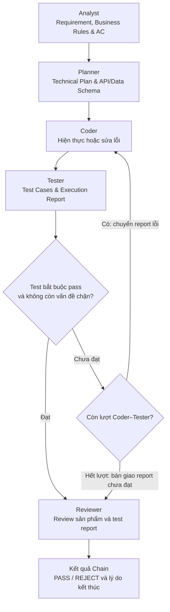
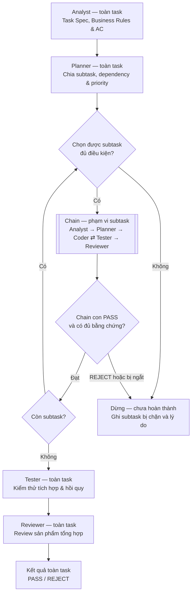

# Các mẫu topology L3

Hai mẫu dưới đây dùng chung năm role Analyst, Planner, Coder, Tester và
Reviewer. Chain đã có node/graph và adapter demo cho Registry, client 9router,
file tool và lệnh chạy local; Subtask Chain còn ở mức định nghĩa. Coordinator hiện cố định chọn Chain; chưa chọn topology thích ứng
hoặc tích hợp Engine/harness benchmark đầy đủ. Xem
[hướng dẫn chạy demo](../../../../../docs/chain_demo.md).

# Chain — vòng lặp Coder–Tester

Chain xử lý một đơn vị công việc: toàn task hoặc một subtask. Analyst và
Planner chạy một lượt, Coder–Tester lặp trong giới hạn, sau đó Reviewer
chốt kết quả. Vì có cạnh phản hồi Tester → Coder, mẫu này không còn là
Linear Chain.

Trong adapter hiện tại, user chat gốc chỉ gửi cho Analyst và Reviewer.
Planner/Coder/Tester nhận WorkSpec/AC/constraints/interface_contracts của Analyst
cùng các artifact cần cho vai trò của mình. Reviewer dùng user chat để đối chiếu
Spec và sản phẩm; việc các role khác đồng ý hoặc test pass không thay thế kiểm tra
yêu cầu gốc. Mỗi role vẫn có context riêng, không nhận toàn bộ hội thoại trước.



| Node ID | Role lõi | Nguồn message trực tiếp trong vòng | Nhiệm vụ | Đầu ra |
| --- | --- | --- | --- | --- |
| `analyst` | Analyst | Task/subtask từ bên gọi | Phân tích requirement, user story, Business Rules, ràng buộc và AC. Khi nhận subtask, làm rõ AC cục bộ và giữ nhất quán với Spec toàn task. | Work Spec, AC có mã định danh, giả định và thông tin còn thiếu. |
| `planner` | Planner | `analyst` | Từ Spec và AC, chọn giải pháp, thiết kế cấu trúc dữ liệu/API Contract, xác định file/module cần sửa, thứ tự thao tác và cách tích hợp. Chain này không tự mở thêm Chain con. | Technical Plan, API/Data Schema Spec và ánh xạ bước thực hiện tới AC. |
| `coder` | Coder | `planner` ở lượt đầu; qua `limit` từ report của `tester` khi sửa lỗi | Hiện thực theo kế hoạch hoặc sửa lỗi Tester báo; tự kiểm tra sơ bộ trước khi bàn giao. Không tự hạ AC hay bỏ test để được pass. | Source Code Patch / Build có version, kết quả tự kiểm tra và mô tả thay đổi. |
| `tester` | Tester | `coder` | Đọc Spec/AC/contract của Analyst và contract mới từ Planner để viết test độc lập; chạy trên đúng patch/build hiện tại và kiểm tra hồi quy liên quan. | Test Case, Test Execution Report, lỗi tái hiện được, AC chưa đạt và vấn đề chặn đã biết. |
| `check` | Không — node điều khiển | `tester` | Kiểm tra toàn bộ test bắt buộc đã pass và không còn vấn đề chặn trên đúng code version. Không coi thiếu test hoặc test chưa chạy là pass. | Đạt: chuyển `reviewer`; chưa đạt: chuyển `limit` cùng report. |
| `limit` | Không — node điều khiển | `check` khi chưa đạt | Kiểm tra còn lượt Coder–Tester hay không. Không chạy lại Analyst/Planner ở mỗi lượt sửa bug. | Còn lượt: chuyển report về `coder`; hết lượt: chuyển report chưa đạt sang `reviewer`. |
| `reviewer` | Reviewer | Qua `check` khi test đạt, hoặc qua `limit` khi hết lượt | Đối chiếu Work Spec, Plan, patch và test report; review tính đúng đắn, mức đáp ứng AC và chất lượng thay đổi. Test còn fail hoặc còn vấn đề chặn thì không kết luận PASS. | Verdict `PASS` / `REJECT`, lý do, bằng chứng và các vấn đề cần sửa. |
| `result` | Không — node điều khiển | `reviewer` | Đóng lần gọi Chain, trả patch, report, verdict và số lượt đã dùng cho bên gọi. Không tự tạo cạnh Reviewer → Coder. | Chain Result cùng phạm vi task/subtask, artifact cuối và lý do kết thúc. |

Spec, Plan, AC, patch và test report là artifact dùng chung có version.
Tester/Reviewer đọc phần liên quan dù không có cạnh message trực tiếp từ
mọi role trước đó; không mặc định nhận toàn bộ lịch sử hội thoại.

## Hợp đồng dùng lại Chain

| Thành phần | Nội dung |
| --- | --- |
| Đầu vào | Run ID, phạm vi `task` hoặc `subtask`, Work ID, requirement, AC, ràng buộc/interface, context từ task cha/dependency, code baseline và giới hạn hiệu lực. |
| Đầu ra | Patch/build version, Spec/Plan, test case/report, verdict, số vòng Coder–Tester thực chạy và lý do kết thúc. |
| Một vòng | Một lượt Coder → Tester, kể cả lượt hiện thực đầu tiên. Analyst/Planner chuẩn bị, Reviewer chốt kết quả. |
| Giới hạn vòng | Trong bản định nghĩa này, `max_rounds` là số lượt Coder → Tester tối đa cho một lần gọi Chain. Ví dụ 3 nghĩa là tối đa ba lượt tổng cộng. |
| Kết thúc bình thường | Test đạt thì sang Reviewer; test chưa đạt và hết lượt cũng sang Reviewer với report chưa đạt. Reviewer trả PASS/REJECT rồi kết thúc lần gọi. |
| Ngắt bất thường | Timeout, hết ngân sách, đầu vào bị chặn hoặc lỗi không phục hồi được dừng sớm và trả kết quả chưa hoàn thành; không bắt buộc gọi thêm Reviewer khi không còn ngân sách. |

Khi patch thay đổi, test/review cũ không chứng minh cho patch mới. Report
phải gắn với code version được đánh giá. Reviewer REJECT không tự kích hoạt
vòng sửa mới; thêm đường phản hồi đó sẽ là thay đổi định nghĩa topology.

## Cấu trúc hợp đồng chuyển giao giữa các role

Role/prompt được nạp từ registry/roles/core và registry/prompts qua models.py/loader.py chung; không có Registry MAS riêng.

Hợp đồng lấy output format của prompt tại commit
`39d39e7eb49917b6f381876cdebb6564b596ebc3` làm nền. Định nghĩa thực thi nằm
trong [chain_state.py](chain_state.py), kiểm tra/bàn giao nằm trong
[chain_nodes.py](chain_nodes.py). Registry chung hiện là 0.17.1, prompt chain-v4.

### Output của role và metadata của framework

| Role | Output model phải trả | Dữ liệu do framework bổ sung |
| --- | --- | --- |
| Analyst | JSON: summary, requirements, constraints, acceptance_criteria, open_questions | ac_catalog: ID ổn định cho từng AC. |
| Planner | JSON: steps gồm id, description, files, depends_on | Node kiểm tra coverage và giữ Plan đầy đủ trong state. |
| Coder | Chỉ unified diff; không JSON hay lời giải thích | Patch thực từ workspace, patch_hash, coder_summary và coder_evidence. |
| Tester | JSON: tests_to_run, results, verdict | Chạy lại suite; kết quả thật, trạng thái/tổng test, patch_hash và execution summary. |
| Reviewer | JSON: decision, summary, comments | Revision stamp và ánh xạ decision sang verdict của Chain. |

Các field mở rộng L3 nằm trong JSON Schema gửi tới model: Analyst có
`interface_contracts`; mỗi bước Planner có `ac_ids`, toàn Plan có
`covered_ac_ids` và `interface_contracts`; Tester có `covered_ac_ids`,
`blocking_issues`; Reviewer có `covered_ac_ids`. Những field này giữ khả
năng kiểm tra AC của Chain. Framework không tự suy ra coverage từ mô tả;
bỏ coverage không thể làm một run được PASS.

`JSON_OUTPUT_MODELS` chứa bốn role JSON. `role_output_model()` còn trả
schema kiểu string cho Coder; `parse_role_output()` kiểm tra JSON hoặc diff
theo đúng role. Model không được khai các field runtime như patch_hash,
tests_run hay metadata thực thi trong JSON Tester/Reviewer.

Adapter trả `RoleHandoff(output, runtime)` khi cần kèm metadata. Node kiểm
tra output theo schema role, rồi tạo artifact điều phối: `CodeOutput`,
`TestReport`, `ReviewReport`. `WorkSpec` và `TechnicalPlan` là alias của
AnalystOutput/PlannerOutput. Runtime artifact có thể nhiều field hơn JSON
mà model được yêu cầu trả; hai lớp dữ liệu phục vụ hai trách nhiệm khác nhau.

### Cấu trúc cụ thể

**AnalystOutput.** requirements là danh sách
`{id, description, priority}`, priority nhận high/medium/low; ID không
trùng và cần ít nhất một requirement. acceptance_criteria là danh sách
chuỗi, cần ít nhất một mục. constraints và open_questions có thể rỗng.
interface_contracts là map tên contract → chữ ký/API, định dạng vào/ra hoặc
quy tắc tương thích, bổ sung cho requirements/AC.

Chain giữ nguyên ID và mô tả AC kế thừa trong WorkItem. AC mới được gán
AC1, AC2, ... trong ac_catalog và bỏ qua ID đã dùng. Spec vẫn lưu AC dạng
chuỗi như prompt của commit; Planner/Tester/Reviewer tham chiếu ID từ catalog.
Ràng buộc kế thừa không được loại bỏ; open_questions đi cùng Spec để các
role sau biết phần còn mơ hồ.

**PlannerOutput.** steps cần ít nhất một bước. Mỗi bước có id là số nguyên
liên tiếp từ 1, description mô tả việc cần làm/lý do, files chứa đường dẫn
repo và depends_on chỉ tham chiếu bước có ID nhỏ hơn. ac_ids gắn bước với
AC trong catalog. covered_ac_ids và hợp các steps[].ac_ids đều phải bằng
tập ID trong ac_catalog. interface_contracts chỉ chứa contract mới hoặc
lựa chọn test command/cwd/env; không chép lại toàn bộ yêu cầu.

**CoderOutput.** Coder trả unified diff đầy đủ, tích lũy so với baseline đầu
run, kể cả khi retry. Nếu không cần thay đổi, được trả chuỗi rỗng; client
chỉ bật chấp nhận response rỗng ở adapter Coder và vẫn kiểm tra usage.
Đây là phần điều chỉnh cho no-op của Chain hiện tại. File đã lưu là nguồn
thật: nếu Coder đã sửa bằng file tools, framework lấy cumulative patch từ
workspace; nếu chỉ trả diff, adapter áp patch theo baseline rồi đọc lại.
coder_summary do framework tạo, không lấy một JSON summary từ model.
coder_evidence chứa tối đa tám receipt tool thật, gồm revision/hash và
matches_final_patch để phân biệt smoke check còn hiệu lực với receipt cũ.

**TesterOutput.** tests_to_run là danh sách test ID; results gồm
`{test, status, details}`, status nhận passed/failed/error/skipped.
Cả hai danh sách cần ít nhất một mục. verdict nhận pass/fail và phải khớp
results: có failed/error thì fail; chỉ passed/skipped thì pass. details
cung cấp assertion/traceback khi lỗi. covered_ac_ids khai AC đã kiểm tra,
blocking_issues ghi phần còn chặn.

Adapter chạy lại cấu hình test cuối và thay results/verdict bằng quan sát
thật. unittest và JUnit có kết quả từng test; backend chỉ có báo cáo tổng
được ghi rõ là một kết quả suite, không tự gán PASS cho từng case. Node
lưu TestReport gồm payload này cùng patch_hash, status, tests_run, failed,
test_cases và summary do thực thi cung cấp. Verdict pass của model chưa
đủ cho Chain PASS: suite rỗng, skip hoặc thiếu coverage vẫn bị chặn.

**ReviewerOutput.** decision nhận approve/reject; comments là danh sách
`{file, line, severity, message}`. file/line có thể null, line nếu có phải
từ 1; severity nhận blocker/major/minor/nit. Reject cần ít nhất một comment;
approve không được có blocker. covered_ac_ids ghi AC thực sự đã đối chiếu.

Node giữ decision/comments trong ReviewReport, thêm patch_hash từ lượt gọi,
ánh xạ approve → PASS, reject → REJECT và tạo blocking_issues từ comment
blocker. Verdict cuối vẫn cần test đạt, coverage đầy đủ và không có blocker.

### Request và dữ liệu qua từng chặng

Request gồm WorkItem (run/task/work ID, scope, requirement, baseline,
AC/ràng buộc kế thừa, parent_context), topology/version, round/max_rounds,
incoming_message, artifacts, output_format và output_schema. incoming_message
ghi bên gửi/nội dung trực tiếp; artifacts cung cấp dữ liệu cần để thực hiện.
Mọi role sau Analyst đều nhận ac_catalog qua artifacts.

| Chặng | Dữ liệu bàn giao chính |
| --- | --- |
| Caller → Analyst | Yêu cầu gốc, repo, AC/ràng buộc kế thừa. |
| Analyst → Planner | Spec gồm requirements, AC dạng chuỗi, constraints, open_questions, contracts; ac_catalog. |
| Planner → Coder | Spec, Plan có bước số nguyên/phụ thuộc/AC coverage; retry thêm TestReport và previous_patch. |
| Coder → Tester | Spec, contract mới của Plan, patch/hash, coder_summary/evidence và ac_catalog. |
| Tester → Coder qua limit | TestReport có lỗi thực tế để sửa; giữ Spec/Plan và giới hạn hiện tại. |
| Tester → Reviewer qua check/limit | Spec, Plan, patch/hash, TestReport và evidence; cùng yêu cầu gốc. |
| Reviewer → Result | ReviewReport, verdict hiệu lực, artifact cuối, số lượt và lý do dừng. |

`chain_handoff.prepare_role_request()` được gọi trong `ChainNodes._call()`
trước khi giao request cho runner. Đây là nơi duy nhất quyết định góc nhìn
của role: user chat gốc chỉ gửi Analyst/Reviewer; Tester chỉ nhận
Plan.interface_contracts; Reviewer nhận Plan.decisions gồm
id/description/files/depends_on/ac_ids cùng contract; Coder nhận đủ steps.
Chính sách này áp dụng cả khi tắt compaction. Spec và catalog giữ đầy đủ,
ChainState và result giữ Plan gốc; log agent_started ghi request đã chọn.
incoming_message có thể dùng field _ref trỏ tới artifact đã có trong request.

Runner ghi nhận repository_changes từ workspace thực tế vào RoleHandoff.runtime
của Coder. Node kiểm tra cấu trúc rồi lưu vào ChainState, đưa vào request sau.
Khi có danh sách này, L3 thay patch dài hơn 2000 ký tự của Tester hoặc
previous_patch của Coder retry bằng tham chiếu file; Reviewer giữ full diff.
Nếu chưa có changed paths từ runner, L3 giữ patch đầy đủ, không tự đoán đường dẫn.

DemoAgentRunner thực thi request đã được chọn, bổ sung listing/môi trường,
gọi LLM và tools. Prompt hydrator ghép system/task, không lọc lại theo role.
Context manager chỉ rút gọn biểu diễn (schema annotations, dữ liệu trùng) và
lịch sử tool/file context trong role; không chứa chính sách bàn giao Chain.
Tắt context.enabled chỉ tắt compaction, không thay dữ liệu role được nhận.

### Giữ nguyên flow và hiệu lực revision

Flow vẫn là Analyst → Planner → Coder ⇄ Tester → Reviewer. check/limit,
max_rounds, timeout và budget guard giữ nguyên; không thêm cạnh sau review.

patch_hash liên kết baseline và patch hiện tại. Sau mỗi lần Coder bàn giao,
Chain xóa report test/review cũ và yêu cầu Tester kiểm tra lại. Hash cũ bị
từ chối bằng stale_test_report/stale_review_report. Output sai trả
invalid_output, Plan sai coverage trả incomplete_plan, lỗi hạ tầng test
trả test_execution_error. Test chưa đạt đi qua limit để xét lặp; hết lượt
vẫn sang Reviewer với report chưa đạt. Reviewer reject kết thúc Chain.

PASS hiệu lực cần test trên đúng hash, status passed, verdict pass, số test
lớn hơn 0, failed bằng 0, có test ID, đủ và đúng AC, không blocker; đồng thời
Reviewer approve, đủ AC và không blocker. ChainState vẫn quản lý collaboration
của một Chain, tách khỏi lifecycle agent Layer 1. Contract đã đổi; resume
checkpoint cũ cần Engine kiểm tra version, chưa nghiệm thu resume toàn harness.

# Subtask Chain — dùng lại Chain cho từng subtask

Subtask Chain phân rã công việc và gọi lại đúng mẫu Chain ở trên cho từng
subtask. Mỗi Chain con có đủ Analyst → Planner → Coder ⇄ Tester → Reviewer;
không phải chỉ dùng lại riêng cặp Coder–Tester.



| Node ID | Role lõi | Nguồn message trực tiếp trong vòng | Nhiệm vụ | Đầu ra |
| --- | --- | --- | --- | --- |
| `task_analyst` | Analyst — toàn task | Task từ controller | Phân tích requirement, Business Rules, ràng buộc và AC toàn task. | Task Spec, AC toàn task, giả định và thông tin còn thiếu. |
| `task_planner` | Planner — toàn task | `task_analyst` | Chia task thành subtask; mô tả phạm vi, interface, AC, dependency, precondition và priority của từng subtask; lập phương án tích hợp. | Subtask Plan và đồ thị phụ thuộc không chu trình. |
| `select` | Không — node điều khiển | `task_planner`; `next` khi còn subtask | Chọn subtask có đủ precondition và dependency hoàn tất; xét priority giữa các subtask đủ điều kiện. Nếu còn việc nhưng không có subtask đủ điều kiện, chuyển `stop`. | Subtask hiện tại và context/artifact bàn giao cho Chain con, hoặc lý do bị chặn. |
| `child_chain` | Dùng lại cả năm role trong Chain | `select` | Gọi mẫu Chain ở trên với phạm vi subtask, AC cục bộ, ràng buộc task cha và artifact dependency. Không tự chọn topology khác cho từng subtask. | Chain Result: patch, test report, verdict, số vòng và lý do kết thúc. |
| `accepted` | Không — node điều khiển | `child_chain` | Xác nhận Chain con PASS, test bắt buộc đạt và không còn vấn đề chặn trên đúng code version; không chỉ tin nhãn PASS nếu thiếu bằng chứng. | Đạt: ghi subtask hoàn tất và chuyển `next`; chưa đạt/bị ngắt: chuyển `stop`. |
| `next` | Không — node điều khiển | `accepted` khi đạt | Kiểm tra còn subtask chưa hoàn tất hay không. | Còn: chuyển `select`; hết: chuyển `integration`. |
| `integration` | Tester — toàn task | `next` khi hết subtask | Chạy test tích hợp, test mục tiêu và test hồi quy trên patch tổng hợp, đối chiếu AC toàn task. | Task Test Execution Report, lỗi tích hợp/hồi quy và AC chưa đạt. |
| `task_reviewer` | Reviewer — toàn task | `integration` | Đối chiếu Spec tổng thể, kế hoạch, các Chain Result, patch cuối và test tích hợp. Chỉ PASS khi test bắt buộc đạt, đáp ứng AC và không còn vấn đề chặn. | Verdict toàn task `PASS` / `REJECT`, lý do và bằng chứng. |
| `result` | Không — node điều khiển | `task_reviewer` | Trả sản phẩm tổng hợp và kết quả nghiệm thu toàn task. Không tự lặp lại cả task hoặc quay trực tiếp về Coder. | Task Result, patch cuối, test report, verdict và thống kê từng subtask. |
| `stop` | Không — node điều khiển | `accepted` khi chưa đạt/bị ngắt; `select` khi không có subtask đủ điều kiện | Dừng khi chưa thể hoàn thành task; không chuyển tiếp các subtask phụ thuộc chưa đủ điều kiện. | Kết quả chưa hoàn thành, Subtask ID liên quan và lý do dừng. |

Các role ở cấp task và trong Chain con là các lượt gọi lại cùng thành viên
đội. Chỉ context và phạm vi công việc thay đổi; không tạo thêm role hay cho
LLM tự ghép topology. Các node điều khiển không phải agent mới.

## Quy tắc phân rã và giới hạn

- Planner tạo số subtask hữu hạn trong trần cấu hình. Mỗi subtask có mô tả,
  interface, AC liên kết AC toàn task, dependency, precondition và priority.
- Dependency đứng trước priority: việc ưu tiên cao vẫn phải đợi dependency
  hoàn tất. Nếu cùng priority, dùng thứ tự ổn định như Subtask ID. Dependency
  thiếu hoặc có chu trình làm kế hoạch không hợp lệ.
- Các subtask chạy tuần tự. Không phân rã đệ quy trong Chain con; chỉ
  Subtask Chain bên ngoài chịu trách nhiệm chia và chọn subtask.
- Mỗi Chain con dùng giới hạn Coder–Tester riêng theo cấu hình hiệu lực;
  toàn run vẫn chịu trần token, thời gian và số subtask dùng chung. Không
  reset ngân sách run khi sang subtask mới.
- Log riêng số vòng của từng Chain con và tổng số vòng Coder–Tester đã chạy;
  không nhầm việc chuyển subtask với một lần sửa bug hoặc vòng đời agent.
- Patch mới phải kiểm tra lại test liên quan, kể cả hồi quy trên phần đã làm
  trước đó. Pass từng subtask chưa chứng minh tích hợp toàn task pass.
- Sau test tích hợp, Reviewer chốt kết quả. Bản định nghĩa này chưa có vòng
  sửa lỗi tích hợp hoặc vòng sửa sau review; không tự thêm các cạnh này.

## Trạng thái thiết kế

Đây là bản nháp theo điều chỉnh của Tuấn: Chain có vòng Coder–Tester và
Subtask Chain dùng lại Chain. Nó thay thế cách mô tả Linear Chain/Loop Chain
ở phiên bản tài liệu trước. Mẫu `chain` version 2 đã cập nhật cạnh phản hồi,
node điều khiển và test cho định nghĩa Chain; chưa hiện thực Subtask Chain.

Coder–Tester loop khác Coder–Reviewer loop trong checklist. Cần đối chiếu
danh sách topology, cách hiểu `max_rounds` và chính sách dừng khi chốt
interface L3; chưa coi các mẫu này là được nhóm duyệt. Verdict nghiệm thu
PASS trong bản nháp yêu cầu cả test đạt và review chấp thuận, chặt hơn điều
kiện dừng OR đang ghi trong checklist. Dừng vì hết giới hạn được log riêng,
không đồng nghĩa task thành công.

## Node Chain hiện có

- [chain_state.py](chain_state.py): WorkItem, ChainLimits, ChainState và schema
  đầu ra của Analyst, Planner, Coder, Tester, Reviewer. State này chỉ quản lý
  collaboration của một Chain, không thay state vòng đời agent ở Layer 1.
- [chain_nodes.py](chain_nodes.py): các node `analyst`, `planner`, `coder`,
  `tester`, `check`, `limit`, `reviewer`, `result`. Mỗi node trả cập nhật state;
  node điều khiển quyết định đường đi bằng code, không gọi thêm LLM.
- [chain_graph.py](chain_graph.py): nối node bằng conditional edge LangGraph
  theo `topologies.CHAIN`, không thay thế Engine dùng chung.
- [l3_collaboration.py](l3_collaboration.py): coordinator tạm cố định chọn
  `chain`, đọc giới hạn vòng từ config/CLI và kiểm tra hard cap trước khi
  dispatch graph factory. CLI lưu quyết định JSON vào kết quả và event;
  chưa có coordinator LLM chọn topology theo task.

`ChainNodes` nhận `runner(role, request)` bất đồng bộ từ bên ngoài. Đã có
`harness/demo_agent.py` nối role/prompt Registry với client 9router và tool
khám phá/chỉnh sửa repo nhiều file, giữ nguyên cây thư mục của project.
Tester chọn lệnh test, thư mục chạy và biến môi trường sau khi đọc repo;
framework tạo cumulative diff nhiều file từ các chỉnh sửa của Coder.
Adapter này chưa phải vòng đời agent đầy đủ ở Layer 1. Phạm vi hiện tại chỉ
đọc user chat/repo rồi cho MAS sửa và chạy code/test trên laptop, không có
sandbox hoặc bước đánh giá độc lập. CLI dùng `currentProject/repo/`
làm workspace ghi trực tiếp, yêu cầu đọc từ `currentProject/requirement/`.
Không coi report do LLM tự khai là bằng chứng test thực thi.

Request có run/task/work ID, scope, requirement, AC/ràng buộc đầu vào,
context task cha, topology/version, vòng hiện tại, message bàn giao,
artifact cần cho role, output_format và schema. Runner trả JSON cho bốn role
hoặc unified diff cho Coder; RoleHandoff kèm quan sát runtime do adapter tạo. Node không gửi toàn bộ events/history cho các role.
Schema cụ thể được định nghĩa trong `chain_state.py` và được đưa vào request.

Coder phải trả patch tổng hợp đầy đủ so với `baseline_ref` của WorkItem, không
phải incremental patch so với lần sửa trước. Node tính SHA-256 từ baseline
và patch; framework gắn revision cho report Tester/Reviewer qua RoleHandoff.
Coder ghi code qua tool hoặc trả unified diff; framework lấy patch từ workspace. Patch rỗng là trường hợp không đổi code, vẫn phải test/review. Nếu đã có sửa file thành công trong lượt Coder, adapter có thể phục hồi diff model sai bằng cumulative patch sinh từ file đã lưu, tự áp lại trong RAM và kiểm tra schema; ghi coder_patch_rebuilt. Không có sửa file thì diff sai vẫn bị từ chối; lỗi sinh/kiểm chứng patch không được bỏ qua. Việc phục hồi không thay gate Tester/Reviewer hoặc tự đánh dấu PASS.
Sau mỗi lần Coder
bàn giao, report test/review cũ bị vô hiệu hóa. PASS hiệu lực yêu cầu test đã
chạy, đủ AC, không còn vấn đề chặn và review cùng patch chấp thuận; verdict
do Reviewer khai vẫn được giữ riêng để truy vết nếu bị node từ chối.

Timeout được kiểm tra trước/sau lời gọi và dùng giới hạn await cho runner.
Adapter vẫn phải bảo đảm tool/subprocess có timeout và dọn tài nguyên đúng;
không chạy công việc chặn event loop hoặc nuốt cancellation. Lỗi tool/test
infrastructure và JSON sai làm Chain dừng rõ lý do, không tạo vòng sửa code ẩn.

`budget_guard(state)` là hook tùy chọn, trả True khi còn ngân sách. Adapter
demo dùng `llm/usage.py` theo toàn run, dừng nếu thiếu usage hoặc vượt token;
chưa có pricing/cost controller chung. CLI demo bọc Chain Result bằng usage,
event, Registry/config snapshot và ghi JSONL từng lời gọi. Schema benchmark
và cơ chế resume toàn harness vẫn chưa có.

### Ví dụ ghép node vào graph

Đây là ví dụ tích hợp; `shared_agent_runner` và `shared_budget_guard` là
dependency phải được Engine cung cấp, chưa phải các hàm đã hiện thực trong repo.

```python
from raac.collaboration.levels.l3_collaboration import (
    ChainLimits, ChainNodes, WorkItem, build_chain_graph, initial_chain_state,
)

work = WorkItem(
    run_id="run-001", task_id="task-001", work_id="task-001",
    scope="task", requirement="Handle empty input", baseline_ref="base-commit",
)
limits = ChainLimits(
    max_rounds=3, hard_max_rounds=4,
    timeout_seconds=120.0, agent_timeout_seconds=30.0,
)
nodes = ChainNodes(shared_agent_runner, budget_guard=shared_budget_guard)
graph = build_chain_graph(nodes)
output = await graph.ainvoke(
    initial_chain_state(work, limits),
    {"recursion_limit": 4 * limits.max_rounds + 12},
)
chain_result = output["result"]
```

State mới được tạo bằng `initial_chain_state`; dùng `scope="subtask"` và
Work ID riêng để gọi cùng Chain cho subtask. Scheduler Subtask Chain chưa có.
Khi dùng checkpointer, Engine phải quản lý thread riêng theo run/work,
resume checkpoint đang có thay vì tạo state mới, đối chiếu version/cấu hình
và khôi phục workspace cùng lifecycle agent. Test hiện chỉ chứng minh resume
state graph với fake agent, chưa chứng minh resume toàn harness/workspace.

### Kiểm thử

Từ gốc repo, dùng Python có LangGraph và Pydantic:

```powershell
$env:PYTHONPATH = 'src'
python -m unittest discover -s tests/mas/unit -p 'test_*.py' -v
```

Các test bao gồm pass ngay, fail rồi sửa, fail tới trần, review REJECT,
report patch cũ, thiếu test/AC, output sai, timeout, hook ngân sách, cách ly
state giữa các lần gọi và checkpoint graph. Unit test dùng dữ liệu giả;
integration test local ở hướng dẫn demo kiểm tra toàn bộ Chain với HTTP mock
và thực thi test trên laptop. Chưa nghiệm thu L3 thích ứng nhiều topology.
